 

<!-- LinkedIn's glyph was dropped from simple-icons, so shields needs it inlined as a data URI -->

---

## Hey, I'm Paulo

  

**Senior Full Stack Engineer at Eleanor Health via X-Team** · Cuiabá, Mato Grosso — Brazil 🇧🇷

Backend-heavy: **Go** on the server, **TypeScript + React** on the frontend.

I build **resilient, data-heavy backends in Go**.
Studying application security taught me more about architecture than any framework did: you design better
once you understand *how systems break*.

- 🧩 Event Sourcing / CQRS, message brokers, idempotency, graceful degradation — in Go
- 🐿️ Small interfaces, explicit errors, bounded concurrency, the standard library first
- 🔭 Currently deep in: Python → Go strangler-fig migrations, observability that actually traces
- ✍️ Writing **65+ posts** at [paulo-vicente.fly.dev](https://paulo-vicente.fly.dev/) — in 🇬🇧 and 🇧🇷

---

## Featured Work

  

| Project | What it is |
| :--- | :--- |
| **[eventsource](https://github.com/0xb0b1/eventsource)** `Go` | Event Sourcing + CQRS, implemented properly — banking domain, append-only log, projections |
| **[taskqueue](https://github.com/0xb0b1/taskqueue)** `Go` `Postgres` | Distributed task queue: scheduling, exponential-backoff retries, bounded worker pools |
| **[gowm](https://github.com/0xb0b1/gowm)** `Go` | A tiling X11 window manager in **pure Go**, no C bindings — xmonad-inspired |
| **[blog](https://github.com/0xb0b1/blog)** `Go` | This blog is a Go binary — `html/template`, markdown content, i18n, shipped on Fly.io |

**Behind closed repos:** a real-time notification service in Go (gRPC + WebSocket delivery, Redis-backed
deduplication, stateless horizontal scaling) — the migration story is written up
[here](https://paulo-vicente.fly.dev/en/posts/rewriting-python-notifications-service-in-go) — plus subscription
and data-ingestion services in Go.

---

## From the Blog

Notes from production, not tutorials.

- 🐿️ [Rewriting a Python Notifications Service in Go](https://paulo-vicente.fly.dev/en/posts/rewriting-python-notifications-service-in-go)
- ⏱️ [Your Change Detection Never Fires If the Payload Carries a Clock](https://paulo-vicente.fly.dev/en/posts/change-detection-never-fires-if-the-payload-carries-a-clock)
- 🗄️ [Idempotency Belongs in the Database](https://paulo-vicente.fly.dev/en/posts/idempotency-belongs-in-the-database)

→ [read everything](https://paulo-vicente.fly.dev/en/posts/) · também [em português](https://paulo-vicente.fly.dev/pt/posts/)

---

## Toolbox

**Languages**

**Data & Infra**

**Daily Drivers**

---

## Stats

<picture>
  <source media="(prefers-color-scheme: dark)" srcset="https://github-profile-summary-cards.vercel.app/api/cards/profile-details?username=0xb0b1&theme=tokyonight" />
  
</picture>

<picture>
  <source media="(prefers-color-scheme: dark)" srcset="https://streak-stats.demolab.com?user=0xb0b1&hide_border=true&theme=tokyonight&ring=00ADD8&fire=00ADD8&currStreakLabel=00ADD8" />
  
</picture>

---

*"Make it correct, make it observable, then make it fast."*

  

